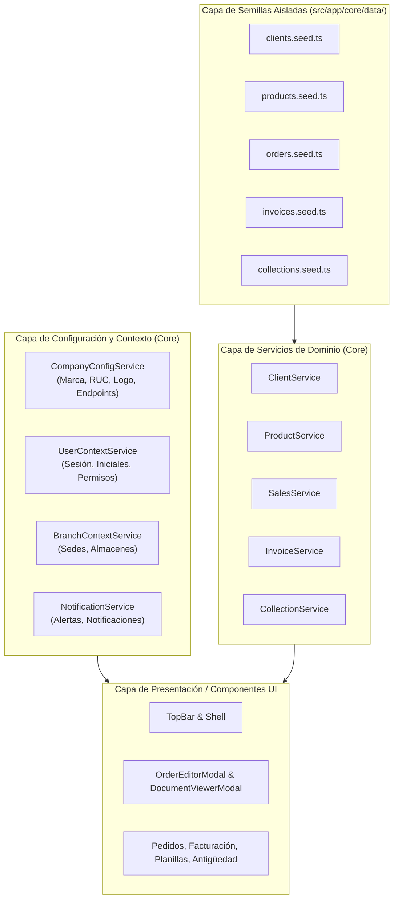

# Guía de Arquitectura Centralizada, Desacoplamiento y Gestión de Datos — ERP Base

Esta guía documenta la arquitectura de centralización del proyecto **ERP Base**. El objetivo primordial es garantizar que **ningún componente de la interfaz de usuario contenga datos fijos (*hardcoded*)**, permitiendo conectar fácilmente APIs reales de backend, sustituir la identidad o marca institucional (logos, razón social, RUC) en caliente y limpiar o purgar datos simulados sin alterar el código de las vistas.

---

## 🧭 1. Resumen de la Arquitectura



---

## 🏢 2. Servicios Centralizados de Configuración y Contexto

Todos los servicios están ubicados en `src/app/core/` y se proveen en el inyector raíz (`providedIn: 'root'`).

### 2.1 `CompanyConfigService` (`src/app/core/config/company-config.service.ts`)
Centraliza los datos de la razón social, RUC, dirección, teléfono, portal web y logotipo de la empresa.

* **Señales reactivas expuestas**:
  * `company()`: Objeto completo de configuración institucional (`CompanyConfig`).
  * `name()`: Razón social (ej. `DISTRIBUIDORA GLOBAL S.A.C. - PE`).
  * `ruc()`: R.U.C. fiscal (ej. `20501234567`).
  * `address()`: Domicilio legal fiscal.
  * `phone()`: Teléfono de central.
  * `email()`: Correo de operaciones.
  * `website()`: Portal web de validación fiscal.
  * `logoUrl()`: URL o ruta de imagen del logo institucional. Si es `null`, se usa el isotipo vectorial SVG.
* **Métodos principales**:
  * `updateConfig(partial: Partial<CompanyConfig>)`: Modifica datos de empresa en tiempo de ejecución.
  * `loadFromApi(endpointUrl: string)`: Realiza una petición `fetch` al endpoint del API del backend y actualiza la configuración automáticamente.
  * `resetToDefault()`: Restaura los valores iniciales.

### 2.2 `UserContextService` (`src/app/core/context/user-context.service.ts`)
Centraliza la información del usuario autenticado, roles y matriz de permisos por módulo.

* **Señales reactivas expuestas**:
  * `username()`: Nombre de usuario (ej. `admin`).
  * `fullName()`: Nombre completo (ej. `Carlos Mendoza Salazar`).
  * `initials()`: Iniciales computadas automáticamente a 2 letras (ej. `CM`).
  * `email()`: Correo del usuario.
  * `role()`: Rol principal asignado.
  * `roles()`: Catálogo de roles disponibles (`['Administrador General', 'Vendedor', ...]`).
  * `permissions()`: Matriz de permisos reactiva con banderas booleanas (`ver`, `crear`, `editar`, `anular`, `exportar`).
* **Métodos principales**:
  * `updateProfile(partial: Partial<UserProfile>)`: Actualiza el perfil del usuario e infiere automáticamente las iniciales si se modifica el nombre.
  * `selectRole(role: string)`: Cambia el rol activo.
  * `updatePermission(modulo: string, field: keyof RolePermission, value: boolean)`: Ajusta permisos por módulo en runtime.
  * `loadFromApi(endpointUrl: string)`: Carga el perfil del usuario desde un endpoint de sesión/auth.

### 2.3 `BranchContextService` (`src/app/core/context/branch-context.service.ts`)
Administra las sedes, sucursales y almacenes operativos de la empresa.

* **Señales reactivas expuestas**:
  * `branches()`: Listado de sucursales (`Branch[]`).
  * `activeBranch()`: Sucursal operativa seleccionada.
  * `activeBranchName()`: Nombre de la sucursal activa mostrado en el TopBar.
* **Métodos principales**:
  * `selectBranch(branchIdOrName: string)`: Conmuta la sede activa.
  * `setBranches(branches: Branch[])`: Reemplaza la lista completa de sedes.
  * `loadFromApi(endpointUrl: string)`: Carga el maestro de sucursales desde el backend.

### 2.4 `NotificationService` (`src/app/core/notifications/notification.service.ts`)
Gestiona el centro de notificaciones operativas desacoplado del Header.

* **Señales reactivas expuestas**:
  * `notifications()`: Arreglo reactivo de notificaciones (`NotificationItem[]`).
  * `unreadCount()`: Número computado de notificaciones no leídas.
* **Métodos principales**:
  * `add(item)`: Agrega una nueva notificación en la primera posición.
  * `dismiss(id)`: Descarta una notificación individual mediante su botón de icono.
  * `clearAll()`: Purga todas las notificaciones (limpieza instantánea).
  * `loadFromApi(endpointUrl: string)`: Carga notificaciones remotas de un API.

---

## 📦 3. Capa de Servicios de Dominio y Semillas Aisladas

Toda la información transaccional y de catálogo se extrae a servicios independientes ubicados en `src/app/core/services/` alimentados por semillas aisladas en `src/app/core/data/`:

| Servicio | Semilla Aislada | Propósito / Vistas Consumidoras |
| :--- | :--- | :--- |
| **`ClientService`** | `clients.seed.ts` | Catálogo de clientes, límites de crédito, RUC y opciones para `SearchableSelect`. Utilizado en `OrderEditorModal` y gestión de clientes. |
| **`ProductService`** | `products.seed.ts` | Maestro de SKUs, descripciones, unidades (`CJA`, `FAR`, `BLS`, `NIU`), precios de lista y stocks. Utilizado en `OrderEditorModal`. |
| **`SalesService`** | `orders.seed.ts` | Pedidos de venta, numeración correlativa (`PED-2026-0891`), aprobación y anulación. Utilizado en `Pedidos`. |
| **`InvoiceService`** | `invoices.seed.ts` | Comprobantes electrónicos (`F001-0004521`), cálculo de IGV y estados de envío. Utilizado en `Facturacion`. |
| **`CollectionService`** | `collections.seed.ts` | Planillas de liquidación de cobranza (`PLC-2026-00381`) y reporte de antigüedad de deuda con semáforo. Utilizado en `Planillas` y `AntiguedadDeuda`. |

---

## 🛠️ 4. Guía Práctica de Uso y Mantenimiento

### Caso A: Cambiar la Razón Social, RUC o Logo Institucional en 1 Paso

Si mañana se desea conectar un nuevo logo o razón social, basta con inyectar `CompanyConfigService`:

```typescript
import { inject } from '@angular/core';
import { CompanyConfigService } from '@/core/config/company-config.service';

const config = inject(CompanyConfigService);

// 1. Cambiar logo por una URL o imagen personalizada:
config.updateConfig({
  logoUrl: 'assets/brand/mi-nuevo-logo.png', // O 'https://mi-dominio.com/logo.svg'
  name: 'NUEVA DISTRIBUIDORA SAC',
  ruc: '20123456789',
  address: 'Av. Las Palmeras 450, San Isidro',
});
```

> [!NOTE]
> Al invocar `updateConfig`, el cambio se refleja **instantáneamente y al mismo tiempo** en:
> 1. El Header / TopBar corporativo.
> 2. La pantalla de Login.
> 3. El componente institucional `ErpLogo`.
> 4. El Visor de Comprobantes Fiscales A4 (`DocumentViewerModal`).

---

### Caso B: Conectar a un Endpoint de API Real

Cada servicio cuenta con métodos preparados para consumir respuestas JSON de un servidor:

```typescript
// En el inicio de la aplicación o en un APP_INITIALIZER:
await companyConfigService.loadFromApi('/api/v1/tenant/config');
await userContextService.loadFromApi('/api/v1/auth/me');
await branchContextService.loadFromApi('/api/v1/branches');
await clientService.loadFromApi('/api/v1/clients');
await productService.loadFromApi('/api/v1/products');
await salesService.loadFromApi('/api/v1/orders');
```

O si se desea utilizar `HttpClient` de Angular con Observables, se reemplaza la implementación interna del servicio sin necesidad de tocar los componentes HTML/SCSS de las vistas.

---

### Caso C: Limpiar Todas las Notificaciones Simuladas o Datos Iniciales

Para dejar la aplicación totalmente limpia para pase a producción o prueba de cliente:

1. **Notificaciones**: Pulsar el botón de icono del cesto de basura en el popover de notificaciones o ejecutar:
   ```typescript
   notificationService.clearAll();
   ```
2. **Catálogos y Transacciones**: Los archivos `src/app/core/data/*.seed.ts` contienen únicamente arreglos exportados. Para dejarlos vacíos, basta con definir:
   ```typescript
   export const INITIAL_CLIENTS_SEED: ClientEntity[] = [];
   export const INITIAL_ORDERS_SEED: OrderEntity[] = [];
   export const INITIAL_INVOICES_SEED: InvoiceEntity[] = [];
   ```
   O invocar en tiempo de ejecución:
   ```typescript
   salesService.clear();
   invoiceService.clear();
   collectionService.clear();
   ```

---

## 🔒 5. Cumplimiento de Reglas Estrictas del Proyecto

1. **Botones Exclusivamente con Iconos**: Tanto el botón para limpiar todas las notificaciones (`clearAllNotifications`) como el de descartar notificaciones individuales (`dismissNotification`) son **estrictamente de icono con `title` y `aria-label`**, cumpliendo la Regla 1 de [`AGENTS.md`](file:///c:/Users/Erick/Documents/Proyectos/YamiDarknezz/erp-base/AGENTS.md).
2. **Separación de Archivos**: Cero templates HTML o estilos SCSS inline en archivos `.ts` (Regla 6).
3. **Cero Mención a "Demo" o "Prueba"**: La UI no expone terminologías provisionales (Regla 4).
4. **Verificación**: Todo cambio se valida con `ng test` y `ng build` (60 pruebas unitarias aprobadas al 100%).
