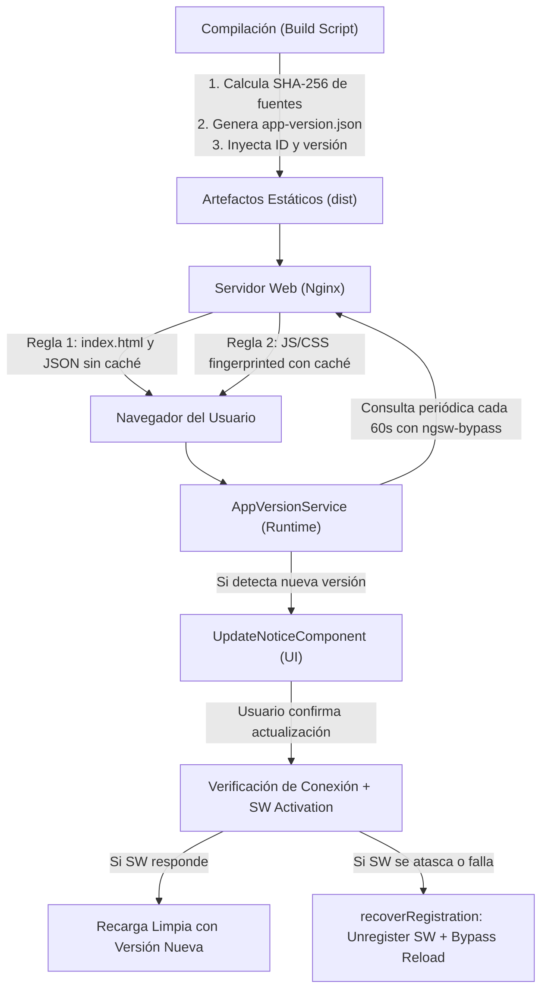

# Guía de Implementación: Sistema de Versionado, Control de Caché y Actualización Segura

> **Basado en la arquitectura real desplegada en MechGuard / Frontend-Ops (rama `develop`)**  
> Documento técnico de referencia para replicar esta solución en cualquier otra aplicación web (Angular, React, Vue o Vanilla JS).

---

## 1. Resumen Ejecutivo y Problema que Resuelve

### La Problemática Clásica de Caché en SPAs y PWAs
Cuando se despliega una nueva versión de una aplicación web moderna (SPA/PWA), surgen tres problemas críticos si no existe una estrategia activa de control de caché y versiones:

1. **`index.html` cacheado por el navegador o CDN**: El navegador del usuario mantiene en memoria la versión antigua del `index.html`. Éste referencia bundles de JavaScript antiguos (`main.[hash-viejo].js`). Al intentar descargarlos tras un nuevo despliegue, el servidor web responde con `404 Not Found`, generando la temida **pantalla blanca** o errores de tipo `ChunkLoadError`.
2. **Service Workers atascados (Stuck Service Worker)**: Los Service Workers de PWA cachean agresivamente los recursos en `CacheStorage`. Si el Service Worker no se actualiza o activa correctamente, el usuario queda "atrapado" indefinidamente en una versión obsoleta.
3. **Pérdida de trabajo por recargas intempestivas**: Recargar la ventana del navegador automáticamente de forma forzada mientras el usuario está llenando un formulario o registrando datos operativos genera frustración y pérdida de datos.

### La Solución Implementada en MechGuard / Frontend-Ops
El sistema implementado en `frontend_central` resuelve estos problemas mediante una arquitectura de **5 capas desacopladas**:



---

## 2. Los 5 Pilares de la Solución

### Pilar 1: Manifiesto Dinámico y Hashing en Tiempo de Compilación
No se depende de Git en producción (útil en entornos Docker donde `.git` suele ignorarse en `.dockerignore`). 
- Se computa un hash **SHA-256** de los archivos de código fuente (`src`, `public`, `package.json`, configuraciones y variables de entorno `NG_APP_*`).
- Se toma la versión semántica de `package.json`.
- Se genera un archivo público estático: `/ops/app-version.json`.
- Se inyecta la versión y el ID del build dentro de la propia aplicación compilada.

### Pilar 2: Política Estricta de Encabezados HTTP en Nginx
Se le instruye al navegador y a proxies intermedios (como Cloudflare) qué archivos deben validarse siempre y cuáles pueden cachearse:
- **`index.html`, `*.json`, `ngsw-worker.js`, `manifest.webmanifest`**: `Cache-Control: "no-cache, no-store, must-revalidate, max-age=0"`.
- **Archivos con hash en el nombre (`.js`, `.css`, imágenes, fuentes)**: `Cache-Control: "public", max-age 6 días`.

### Pilar 3: Monitoreo Asíncrono no Invasivo en Runtime
El servicio `AppVersionService`:
- Se ejecuta **fuera de la zona de Angular (`NgZone.runOutsideAngular`)** para no retrasar la inicialización ni interferir con la estabilidad de la app.
- Consulta `app-version.json` usando `cache: 'no-store'`, un timestamp anticaché `?check=${Date.now()}` y el parámetro `ngsw-bypass=true` (que le ordena al Service Worker no responder desde su caché interna).
- Monitorea periódicamente (cada 60 segundos sólo si la pestaña está visible) y en eventos clave (`focus`, `online`, `visibilitychange`), con throttling para no saturar.

### Pilar 4: Experiencia de Usuario y No Destrucción de Datos
- **Aviso visual no invasivo**: Muestra una notificación flotante informando que hay una versión disponible y permitiendo al usuario posponer ("Más tarde") o actualizar ("Actualizar a X.X.X").
- **Conservación de sesión y borradores**: La sesión (`access_token`, usuario en `localStorage`) **no se borra** intempestivamente. Los usuarios no tienen que volver a autenticarse tras actualizar.
- **Pre-check de conexión**: Antes de recargar, hace un ping rápido de 5 segundos al servidor para validar que el usuario no esté offline, evitando que abandone un formulario si no hay internet disponible.

### Pilar 5: Auto-recuperación ante Service Workers Corruptos (`Self-Healing`)
Si el Service Worker no responde en 4 segundos o la activación tarda más de 1.5 segundos:
- Se ejecuta `recoverRegistration()`: localiza el Service Worker correspondiente a este scope y ejecuta `registration.unregister()`.
- Realiza una recarga forzada pasando `?ngsw-bypass=true&_ops_update=[id]`.
- En el arranque subsiguiente, la aplicación limpia estos parámetros de la barra de direcciones con `history.replaceState`.

---

## 3. Código y Archivos de Implementación (Paso a Paso)

### Archivo 1: Script de Build (`scripts/build.cjs`)
Este script se ejecuta durante `npm run build`:

```javascript
// scripts/build.cjs
const fs = require('node:fs');
const path = require('node:path');
const crypto = require('node:crypto');
const { spawnSync } = require('node:child_process');

const root = path.resolve(__dirname, '..');
const pkg = require('../package.json');

// 1. Calcular hash SHA-256 de todo el código relevante
const hash = crypto.createHash('sha256');

function digest(relative) {
  const full = path.join(root, relative);
  if (!fs.existsSync(full) || relative === 'public/app-version.json') return;
  if (fs.statSync(full).isDirectory()) {
    for (const child of fs.readdirSync(full).sort()) {
      digest(`${relative}/${child}`);
    }
  } else {
    hash.update(relative).update(fs.readFileSync(full));
  }
}

// Escanear carpetas fuente y configuraciones
for (const entry of ['src', 'public', 'scripts', 'package.json', 'angular.json', 'ngsw-config.json', 'fix-ngsw.js']) {
  digest(entry);
}

// Incluir variables de entorno que alteran la compilación
if (fs.existsSync(path.join(root, '.env'))) {
  hash.update(fs.readFileSync(path.join(root, '.env')));
}
for (const key of Object.keys(process.env).filter(k => k.startsWith('NG_APP_')).sort()) {
  hash.update(key).update(process.env[key] || '');
}

// 2. Generar metadatos del build
const metadata = {
  version: pkg.version,
  id: hash.digest('hex').slice(0, 12), // ID único de 12 caracteres hex
  builtAt: new Date().toISOString(),
  storageSchema: 2
};

// 3. Escribir el manifiesto en la carpeta public para que se sirva estáticamente
fs.writeFileSync(path.join(root, 'public/app-version.json'), JSON.stringify(metadata, null, 2));

console.log(`[BUILD] Generando versión ${metadata.version} (Build ID: ${metadata.id})`);

// 4. Ejecutar el comando de compilación del framework (Angular / Vite / etc.)
const buildArgs = ['build', '--base-href', '/ops/', ...process.argv.slice(2)];
const result = spawnSync(
  process.execPath,
  [require.resolve('@angular/cli/bin/ng'), ...buildArgs],
  {
    cwd: root,
    stdio: 'inherit',
    env: {
      ...process.env,
      NG_APP_APP_VERSION: metadata.version,
      NG_APP_BUILD_ID: metadata.id,
      NG_APP_BUILD_TIME: metadata.builtAt
    }
  }
);

if (result.status !== 0) {
  process.exit(result.status || 1);
}

// 5. Verificación de integridad post-build
require('../fix-ngsw.js');
```

---

### Archivo 2: Verificación de Integridad Post-Build (`fix-ngsw.js`)
Garantiza que la compilación realmente incrustó el ID del build y que los hashes del manifiesto del Service Worker son válidos:

```javascript
// fix-ngsw.js
const fs = require('node:fs');
const path = require('node:path');
const crypto = require('node:crypto');

const root = path.join(__dirname, 'dist/mechguard-frontend/browser');
const manifestPath = path.join(root, 'ngsw.json');
const versionPath = path.join(root, 'app-version.json');

if (!fs.existsSync(manifestPath) || !fs.existsSync(versionPath)) {
  console.log('[PWA] Omitiendo validación: manifiestos no presentes en dist.');
  process.exit(0);
}

const manifest = JSON.parse(fs.readFileSync(manifestPath, 'utf8'));
const version = JSON.parse(fs.readFileSync(versionPath, 'utf8'));

// Validar que al menos un archivo JS contenga el ID público del build
const hasBuildId = fs.readdirSync(root)
  .filter(file => file.endsWith('.js'))
  .some(file => fs.readFileSync(path.join(root, file), 'utf8').includes(version.id));

if (!hasBuildId) {
  throw new Error('El ID público de build no coincide con los archivos compilados.');
}

// Validar que los hashes en ngsw.json coincidan con los archivos físicos
for (const [url, expected] of Object.entries(manifest.hashTable)) {
  const filePath = path.join(root, url.replace(/^\/ops\//, ''));
  if (fs.existsSync(filePath)) {
    const actual = crypto.createHash('sha1').update(fs.readFileSync(filePath)).digest('hex');
    if (actual !== expected) {
      throw new Error(`Hash inválido para el recurso PWA: ${url}`);
    }
  }
}

console.log('[PWA] Verificación exitosa de activos y manifiesto.');
```

---

### Archivo 3: Configuración de Nginx (`nginx.conf`)
La configuración que erradica la caché fantasma de versiones viejas:

```nginx
# nginx.conf
server {
    listen 3000;
    server_name localhost;

    port_in_redirect off;
    absolute_redirect off;

    root /usr/share/nginx/html;
    index index.html;

    location /ops {
        alias /usr/share/nginx/html/;
        try_files $uri $uri/ /ops/index.html;

        # REGLA DE ORO 1: CERO CACHÉ para index.html, JSON y Service Workers
        location ~* (?:index\.html|ngsw-worker\.js|ngsw\.json|manifest\.webmanifest|\.json)$ {
            expires -1;
            add_header Cache-Control "no-cache, no-store, must-revalidate, max-age=0";
            add_header Pragma "no-cache";
        }

        # REGLA DE ORO 2: CACHÉ PROLONGADA para estáticos con fingerprint (JS, CSS, imágenes)
        location ~* \.(?:ico|css|js|gif|jpe?g|png|woff2?|eot|ttf|svg)$ {
            expires 6d;
            add_header Cache-Control "public";
        }
    }

    location = / {
        return 301 /ops/;
    }
}
```

---

### Archivo 4: Definición del Build en el Frontend (`src/app/core/version/app-build.ts`)

```typescript
// src/app/core/version/app-build.ts
import { version as packageVersion } from '../../../../package.json';

export const APP_BUILD = Object.freeze({
  version: String((import.meta as any).env?.NG_APP_APP_VERSION || packageVersion),
  id: String((import.meta as any).env?.NG_APP_BUILD_ID || 'local'),
  builtAt: String((import.meta as any).env?.NG_APP_BUILD_TIME || ''),
});
```

---

### Archivo 5: Servicio de Versiones y Actualización (`app-version.service.ts`)

```typescript
// src/app/core/version/app-version.service.ts
import { DestroyRef, Injectable, InjectionToken, NgZone, inject, isDevMode, signal } from '@angular/core';
import { SwUpdate } from '@angular/service-worker';
import { ConfirmationService } from '../../shared/services/confirmation.service';
import { APP_BUILD } from './app-build';

export const APP_UPDATE_MONITOR_ENABLED = new InjectionToken<boolean>('APP_UPDATE_MONITOR_ENABLED', {
  providedIn: 'root',
  factory: () => !isDevMode(),
});

export interface RemoteVersionInfo {
  id: string;
  version: string;
  builtAt?: string;
}

@Injectable({ providedIn: 'root' })
export class AppVersionService {
  readonly current = APP_BUILD;
  readonly available = signal(false);
  readonly latestVersion = signal<string | null>(null);
  readonly dismissed = signal(false);
  readonly checking = signal(false);
  readonly installing = signal(false);
  readonly status = signal('');
  readonly feedback = signal('');
  readonly usageHintVisible = signal(false);

  private readonly enabled = inject(APP_UPDATE_MONITOR_ENABLED);
  private readonly sw = inject(SwUpdate, { optional: true });
  private readonly confirmation = inject(ConfirmationService);
  private readonly zone = inject(NgZone);
  private readonly destroy = inject(DestroyRef);

  private started = false;
  private latestId: string | null = null;
  private workerTask: Promise<boolean> | null = null;

  start(): void {
    if (this.started || !this.enabled) return;
    this.started = true;

    // Si venimos de una recarga de recuperación con bypass, limpiamos la URL
    const address = new URL(window.location.href);
    if (
      address.searchParams.get('_ops_update') === this.current.id &&
      address.searchParams.get('ngsw-bypass') === 'true'
    ) {
      address.searchParams.delete('_ops_update');
      address.searchParams.delete('ngsw-bypass');
      window.history.replaceState(window.history.state, '', address);
    }

    // Escuchar eventos del Service Worker de Angular si está activo
    const events = this.sw?.versionUpdates.subscribe(event => {
      if (event.type === 'VERSION_READY') {
        this.zone.run(() => {
          this.available.set(true);
          void this.check();
        });
      }
    });

    const broken = this.sw?.unrecoverable.subscribe(() => {
      this.zone.run(() => {
        this.available.set(true);
        this.dismissed.set(false);
        this.status.set('La aplicación necesita actualizarse. Guarda tu trabajo antes de continuar.');
      });
    });

    // POLLING FUERA DE ANGULAR ZONE:
    // Evita retener el ciclo de detección de cambios de Angular o bloquear la hidratación.
    this.zone.runOutsideAngular(() => {
      // 1. Verificación inicial tras 1 segundo
      const initial = window.setTimeout(() => this.zone.run(() => { void this.check(); }), 1_000);

      // 2. Intervalo periódico cada 60 segundos (solo si la ventana es visible)
      const timer = window.setInterval(() => {
        if (document.visibilityState === 'visible') {
          this.zone.run(() => { void this.check(); });
        }
      }, 60_000);

      // 3. Verificación al enfocar ventana o recuperar conexión
      let lastResume = 0;
      const resume = () => {
        if (document.visibilityState !== 'visible' || Date.now() - lastResume < 10_000) return;
        lastResume = Date.now();
        this.zone.run(() => { void this.check(); });
      };

      window.addEventListener('focus', resume);
      window.addEventListener('online', resume);
      document.addEventListener('visibilitychange', resume);

      this.destroy.onDestroy(() => {
        window.clearTimeout(initial);
        window.clearInterval(timer);
        window.removeEventListener('focus', resume);
        window.removeEventListener('online', resume);
        document.removeEventListener('visibilitychange', resume);
      });
    });

    this.destroy.onDestroy(() => {
      events?.unsubscribe();
      broken?.unsubscribe();
    });
  }

  private withTimeout<T>(operation: Promise<T>, ms: number): Promise<T> {
    return new Promise((resolve, reject) => {
      const timer = window.setTimeout(() => reject(new Error('Update request timed out')), ms);
      operation.then(
        value => { window.clearTimeout(timer); resolve(value); },
        error => { window.clearTimeout(timer); reject(error); }
      );
    });
  }

  /**
   * Consulta el manifiesto app-version.json directo a la red saltando el Service Worker.
   */
  private async readLatest(timeout = 15_000): Promise<RemoteVersionInfo> {
    const url = new URL('app-version.json', document.baseURI);
    url.searchParams.set('ngsw-bypass', 'true');
    url.searchParams.set('check', String(Date.now()));

    const controller = new AbortController();
    try {
      return await this.withTimeout(
        (async () => {
          const response = await fetch(url, { cache: 'no-store', signal: controller.signal });
          if (!response.ok) throw new Error('Version unavailable');
          const remote = await response.json();
          if (!/^[a-f0-9]{12}$/.test(remote.id) || !/^\d+\.\d+\.\d+(?:-[\w.-]+)?$/.test(remote.version)) {
            throw new Error('Invalid version payload');
          }
          return remote;
        })(),
        timeout
      );
    } finally {
      controller.abort();
    }
  }

  private prepareWorker(): Promise<boolean> {
    if (!this.sw?.isEnabled) return Promise.resolve(false);
    if (!this.workerTask) {
      this.workerTask = this.withTimeout(this.sw.checkForUpdate(), 20_000).finally(() => {
        this.workerTask = null;
      });
    }
    return this.workerTask;
  }

  async check(manual = false): Promise<void> {
    if (this.checking() || this.installing()) return;
    if (manual) this.feedback.set('');

    if (this.current.id === 'local') {
      this.status.set('Versión local de desarrollo');
      if (manual) this.feedback.set(this.status());
      return;
    }

    this.checking.set(true);
    try {
      const remote = await this.readLatest();
      if (remote.id !== this.current.id) {
        if (remote.id !== this.latestId || manual) this.dismissed.set(false);
        this.latestId = remote.id;
        this.latestVersion.set(remote.version);
        this.available.set(true);
      } else {
        this.available.set(false);
        this.latestVersion.set(null);
        this.latestId = null;
      }
      this.status.set(
        this.available()
          ? `Versión ${remote.version} disponible`
          : 'Estás usando la versión más reciente.'
      );
      void this.prepareWorker().catch(() => undefined);
    } catch {
      this.status.set('No se pudo comprobar la versión. Revisa tu conexión y vuelve a intentarlo.');
    } finally {
      this.checking.set(false);
      if (manual && !this.available()) this.feedback.set(this.status());
    }
  }

  /**
   * Procedimiento de actualización seguro:
   * 1. Solicita confirmación al usuario (para no interrumpir formularios abiertos).
   * 2. Comprueba conexión al servidor.
   * 3. Descarga y activa Service Worker con timeouts acotados.
   * 4. Si el Service Worker falla o se congela, ejecuta auto-recuperación (unregister).
   * 5. Recarga la página.
   */
  async update(): Promise<void> {
    if (this.installing()) return;
    const target = this.latestVersion();

    const accepted = await this.confirmation.confirm({
      title: target ? `Actualizar a ${target}` : 'Actualizar la plataforma',
      message: `Versión actual: ${this.current.version}. La página se recargará. Guarda o termina las fichas abiertas antes de continuar. Tu sesión se conservará.`,
      confirmText: target ? `Actualizar a ${target}` : 'Actualizar ahora',
      cancelText: 'Seguir trabajando',
    });

    if (!accepted) return;

    this.installing.set(true);
    try {
      if (!navigator.onLine) throw new Error('Offline');

      // Validar que el servidor responde antes de recargar
      const latest = await this.readLatest(5_000);
      this.latestId = latest.id;

      if (this.sw?.isEnabled) {
        try {
          await this.withTimeout(this.prepareWorker(), 4_000);
          const activated = await this.withTimeout(this.sw.activateUpdate(), 1_500);
          if (!activated && latest.id !== this.current.id) {
            throw new Error('Worker did not activate the new version');
          }
          this.reload();
          return;
        } catch {
          this.status.set('Preparando una recarga para completar la actualización…');
          await this.recoverRegistration();
        }
      }

      // Recarga con bypass si no hay SW o si falló
      this.reload(true);
    } catch {
      this.status.set('No se pudo descargar la actualización. Tu trabajo se conserva; vuelve a intentarlo.');
      this.dismissed.set(false);
      this.installing.set(false);
    }
  }

  /**
   * Desregistra el Service Worker corrupto únicamente para el scope de esta aplicación.
   * No destruye datos de otras aplicaciones ni borra tokens.
   */
  private async recoverRegistration(): Promise<void> {
    try {
      await this.withTimeout(
        (async () => {
          const registration = await navigator.serviceWorker?.getRegistration(document.baseURI);
          const expected = new URL(document.baseURI);
          const worker = registration?.active || registration?.waiting || registration?.installing;
          if (
            registration?.scope === expected.href &&
            worker &&
            new URL(worker.scriptURL).pathname === `${expected.pathname}ngsw-worker.js`
          ) {
            await registration.unregister();
          }
        })(),
        1_500
      );
    } catch {
      // Si falla, el reload forzará el bypass de todas maneras
    }
  }

  private reload(bypass = false): void {
    if (!bypass) {
      window.location.reload();
      return;
    }
    const address = new URL(window.location.href);
    address.searchParams.set('ngsw-bypass', 'true');
    address.searchParams.set('_ops_update', this.latestId || this.current.id);
    window.location.replace(address.href);
  }
}
```

---

### Archivo 6: Componente Notificación Flotante (`update-notice.component.ts`)

```typescript
// src/app/core/version/update-notice.component.ts
import { Component, inject } from '@angular/core';
import { AppVersionService } from './app-version.service';

@Component({
  selector: 'app-update-notice',
  standalone: true,
  template: `
    @if (version.available() && !version.dismissed()) {
      <aside class="update-notice" aria-label="Actualización de la plataforma" aria-live="polite">
        <div class="update-mark">🔄</div>
        <div class="update-content">
          <strong>{{ version.latestVersion() ? 'Nueva versión ' + version.latestVersion() : 'Hay una nueva versión' }}</strong>
          <p>Actualiza cuando termines tu registro actual.</p>
          @if (version.status()) { <small>{{ version.status() }}</small> }
          <div class="update-actions">
            <button type="button" class="btn-primary" (click)="version.update()" [disabled]="version.installing()">
              {{ version.installing() ? 'Actualizando…' : version.latestVersion() ? 'Actualizar a ' + version.latestVersion() : 'Actualizar ahora' }}
            </button>
            <button type="button" class="btn-secondary" (click)="version.dismissed.set(true)" [disabled]="version.installing()">
              Más tarde
            </button>
          </div>
        </div>
      </aside>
    }
  `,
  styles: [`
    .update-notice {
      position: fixed; right: 24px; bottom: 24px; z-index: 9999;
      display: flex; gap: 14px; max-width: 380px; padding: 18px;
      border: 1px solid #cbdafa; border-radius: 16px; background: #ffffff;
      box-shadow: 0 12px 35px rgba(23, 44, 91, 0.18); font-family: sans-serif;
    }
    .update-mark { font-size: 24px; }
    .update-content strong { display: block; font-size: 15px; color: #142b51; }
    .update-content p { margin: 6px 0; font-size: 13px; color: #61738f; }
    .update-actions { display: flex; gap: 8px; margin-top: 12px; }
    .btn-primary { cursor: pointer; border: 0; border-radius: 8px; padding: 8px 12px; background: #2457de; color: white; font-weight: 600; font-size: 12px; }
    .btn-secondary { cursor: pointer; border: 0; border-radius: 8px; padding: 8px 12px; background: #edf2fa; color: #36547e; font-size: 12px; }
  `]
})
export class UpdateNoticeComponent {
  readonly version = inject(AppVersionService);
}
```

---

## 4. Diferencia Clave: ¿Se Borra la Sesión o Sólo la Caché?

En la implementación de MechGuard:
- **Se borra / invalida**:
  - Toda la caché de red (`Cache-Control: no-cache, no-store`).
  - El Service Worker desactualizado (`recoverRegistration()` + `unregister()`).
  - Las cachés internas de consultas en memoria del frontend (e.g. `clearCache()` en servicios de datos).
- **Se preserva intencionalmente**:
  - `access_token` y `user` en `localStorage` (para que los choferes y supervisores no tengan que volver a iniciar sesión).
  - Los borradores de formularios activos (`drafts`).
- **Cuándo sí se limpia el almacenamiento**:
  - En el **Logout explícito** (`auth.service.ts`):
    ```typescript
    logout() {
      localStorage.removeItem('access_token');
      localStorage.removeItem('refresh_token');
      localStorage.removeItem('user');
      localStorage.removeItem('selected_project');
      if (typeof window !== 'undefined' && window.sessionStorage) {
        window.sessionStorage.clear();
      }
      window.location.replace('/ops/login');
    }
    ```

---

## 5. Módulo Adicional: Purga Agresiva Total (Hard Reset de Cookies, CacheStorage, LocalStorage e IndexedDB)

Si en la otra página donde vas a implementar esto necesitas **borrar absolutamente todo** (cookies de sesión, CacheStorage del navegador, LocalStorage e IndexedDB) al detectar una versión incompatible o en un botón de "Limpiar y actualizar", puedes incorporar este método en el servicio:

```typescript
/**
 * Realiza una purga destructiva completa del almacenamiento del navegador
 * antes de recargar la aplicación.
 */
export async function hardPurgeAllClientData(): Promise<void> {
  // 1. Borrar todas las entradas en CacheStorage (Service Worker Caches)
  if ('caches' in window) {
    try {
      const cacheKeys = await window.caches.keys();
      await Promise.all(cacheKeys.map(key => window.caches.delete(key)));
      console.log('[Purge] CacheStorage limpiado con éxito.');
    } catch (e) {
      console.warn('[Purge] Error limpiando CacheStorage:', e);
    }
  }

  // 2. Desregistrar todos los Service Workers registrados
  if ('serviceWorker' in navigator) {
    try {
      const registrations = await navigator.serviceWorker.getRegistrations();
      await Promise.all(registrations.map(reg => reg.unregister()));
      console.log('[Purge] Service Workers desregistrados.');
    } catch (e) {
      console.warn('[Purge] Error desregistrando Service Workers:', e);
    }
  }

  // 3. Borrar LocalStorage y SessionStorage
  try {
    window.localStorage.clear();
    window.sessionStorage.clear();
    console.log('[Purge] LocalStorage y SessionStorage vaciados.');
  } catch (e) {
    console.warn('[Purge] Error en storage:', e);
  }

  // 4. Borrar Cookies accesibles desde JavaScript
  try {
    const cookies = document.cookie.split(';');
    for (const cookie of cookies) {
      const eqPos = cookie.indexOf('=');
      const name = eqPos > -1 ? cookie.substr(0, eqPos).trim() : cookie.trim();
      // Expirar la cookie en el dominio y path actual
      document.cookie = `${name}=;expires=Thu, 01 Jan 1970 00:00:00 GMT;path=/`;
      document.cookie = `${name}=;expires=Thu, 01 Jan 1970 00:00:00 GMT;path=/;domain=${window.location.hostname}`;
    }
    console.log('[Purge] Cookies eliminadas.');
  } catch (e) {
    console.warn('[Purge] Error eliminando cookies:', e);
  }

  // 5. Borrar bases de datos IndexedDB
  if ('indexedDB' in window && typeof window.indexedDB.databases === 'function') {
    try {
      const dbs = await window.indexedDB.databases();
      for (const db of dbs) {
        if (db.name) {
          window.indexedDB.deleteDatabase(db.name);
        }
      }
      console.log('[Purge] IndexedDB borradas.');
    } catch (e) {
      console.warn('[Purge] Error borrando IndexedDB:', e);
    }
  }

  // 6. Recarga dura desde el servidor
  window.location.href = window.location.origin + window.location.pathname + '?reset=' + Date.now();
}
```

---

## 6. Adaptación para React / Vite / Vue / Next.js

Si la otra página está construida con **React + Vite** (o Vue), el concepto es exactamente el mismo:

1. **En Vite (`vite.config.ts`)**:
   - Generar el `public/app-version.json` usando un plugin simple o script previo en `package.json`: `"build": "node scripts/generate-version.cjs && vite build"`.
2. **Definir en Vite las variables**:
   ```typescript
   // vite.config.ts
   import { defineConfig } from 'vite';
   import versionInfo from './public/app-version.json';

   export default defineConfig({
     define: {
       __APP_VERSION__: JSON.stringify(versionInfo.version),
       __BUILD_ID__: JSON.stringify(versionInfo.id),
     }
   });
   ```
3. **Hook en React (`useAppVersion.ts`)**:
   - Crear un hook que ejecute el `fetch('/app-version.json?check=' + Date.now(), { cache: 'no-store' })` en un `setInterval` de 60 segundos y devuelva `{ available, latestVersion, updateApp }`.
4. **Nginx**:
   - Mantener las mismas directivas `Cache-Control` explicadas en la Sección 3 (Archivo 3).

---

## 7. Checklist de Verificación para tu Nueva Página

- [ ] **Script de Build**: ¿Crea `public/app-version.json` con `version`, `id` (hash único) y `builtAt`?
- [ ] **Nginx / Servidor**: ¿Tiene `index.html` y `*.json` configurados con `no-cache, no-store, must-revalidate`?
- [ ] **Inyección de Identificador**: ¿La aplicación sabe en qué `BUILD_ID` está corriendo en runtime?
- [ ] **Servicio de Consulta**: ¿El `fetch` incluye `cache: 'no-store'` y un parámetro único `?check=Date.now()`?
- [ ] **Protección con Timeouts**: ¿Las llamadas al worker y a la red tienen límites de tiempo (entre 1.5s y 15s) para evitar que una red lenta cuelgue la UI?
- [ ] **Experiencia del Usuario**: ¿Avisa mediante un diálogo o toast antes de recargar, dando la opción de "Más tarde"?
- [ ] **Manejo de Recuperación**: ¿Desregistra Service Workers atascados y recarga con bypass si algo falla?
